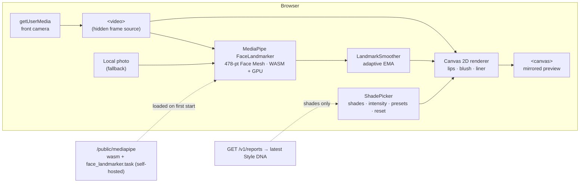

# Virtual Try-On — Parts 6.1–6.3

Live makeup preview at **`/try-on`**: lipstick, blush and eyeliner mapped to the face in real time, with shades from the user's Style DNA. Everything runs **in the browser**. Camera frames and photos are never uploaded, stored or sent to any server.

## Architecture (6.1)



| Concern | Decision | Why |
|---|---|---|
| Face tracking | `@mediapipe/tasks-vision` **FaceLandmarker** (0.10.21) | Current official home of the Face Mesh model: same 478-landmark topology, GPU delegate. The legacy `@mediapipe/face_mesh` package is deprecated |
| Loading | Dynamic `import()` on **Start camera / Use a photo** only | ~1 MB JS + WASM + 3.8 MB model never hit other pages or users who don't start a try-on |
| Hosting | Self-hosted in `apps/web/public/mediapipe/` by `scripts/fetch-mediapipe-assets.mjs` (`predev`/`prebuild`, git-ignored) | No request to Google during a try-on; falls back to Google's model URL only if the local file is missing |
| Delegate | GPU → CPU fallback | Works on machines without WebGL |
| Rendering | **Canvas 2D** with composite blend modes | `color`/`multiply` blending gives realistic results; WebGL adds complexity without a visible gain for three overlays. The single canvas also makes snapshots trivial |
| Jitter | Adaptive exponential smoothing (One-Euro-style) | Steady when still, no lag when moving |
| Mirroring | Frame drawn with `scale(-1, 1)`; landmarks mapped with `x → 1 − x` | Selfie view matches user expectation; overlays stay aligned |

### Landmarks → overlay positioning

Indices follow MediaPipe's canonical Face Mesh, with left/right meaning the **subject's** side (`lib/tryon/landmarks.ts`).

| Overlay | Landmarks | Geometry |
|---|---|---|
| Lips | Outer contour (20 pts, `61…146`) minus inner contour (20 pts, `78…95`) | Even-odd fill, so teeth and tongue stay uncoloured. Midpoint-quadratic smoothing removes polygon corners |
| Blush | Cheek apples `50` / `280` | Radial gradient, ellipse 1.25 × 0.85, rotated by **head roll** (outer eye corners `33`/`263`) |
| Eyeliner | Upper lash lines `33…133`, `263…362` | Ribbon offset toward the brow (normal chosen by lid side), tapered 2.5 % → 8.5 % of eye width; optional wing along the eye axis plus a lift |
| Scale | Face width `234` ↔ `454` | Every size is relative, so overlays stay proportional at any distance |

### Blending (6.2)

| Layer | Composite | Effect |
|---|---|---|
| Lips | `multiply` 0.30 + `color` 0.75 (× intensity), blur ≈ 0.4 % face width | `color` keeps the skin's luminance, so lip texture and highlights show through |
| Blush | `multiply` 0.35 + `color` 0.30 (× intensity), blur 1 % | Soft flush that fades to nothing at the edge |
| Liner | `multiply` 0.45–1.0, blur ≈ 0.15 % | Crisp but not pasted-on |

### Camera permission & capture flow

```
idle ──Start camera──► requesting ──granted──► loading (model, first time only) ──► live
  ▲                        │ NotAllowed/Security ─► denied       (Alert + "Try again" + photo option)
  │                        │ NotFound/Overconstrained ─► unavailable (photo option)
  │                        └ NotReadable ─► error ("camera in use by another app")
  └──── Stop camera / tab hidden / leave page (tracks stopped, camera light off) ◄── live
```

- Requires a secure context (HTTPS or `localhost`); `Permissions-Policy: camera=(self)` is set in `next.config.mjs`.
- The camera is released whenever the tab is hidden or the page unmounts, so it is never left on in the background.
- **Use a photo:** the same pipeline in `IMAGE` mode on a local file (downscaled to ≤ 1600 px), repainted on every change. The file never leaves the browser.
- **Before / after** toggle and **Save snapshot** (PNG download, local).

## Shade picker & personalisation (6.3)

`lib/tryon/shades.ts` builds a `ShadeSet` (lips / blush / liner):

| Source | Lips | Blush | Liner |
|---|---|---|---|
| **Style DNA** (signed in, latest report) | `makeup.lip.*` recommendations with `color_hex` | `makeup.cheek.*` | Palette colours with luminance < 0.2 (slate, navy, teal, berry…) |
| Always appended (deduplicated by colour) | 6 starter shades | 4 | Black, espresso, ink navy, plum, bronze |
| Guests or no report | Starter set, labelled **"not personalised"**, with a link to build a Style DNA | | |

The UI (`components/tryon/ShadePicker.tsx`) offers:
- **Per-layer controls:** on/off switch (`role="switch"`), swatches on **native radios** (arrow keys move between shades, and screen readers announce "recommended for you"), an intensity slider (10–100 %), and a liner wing toggle.
- **Combinations:** *Natural*, *Everyday* and *Evening* presets built from the current shade set (Evening picks the deepest lip and liner). Any manual change clears the preset highlight.
- **Reset:** returns to the starting look (top recommended lip at 60 %, blush and liner off) and turns off before/after.
- The recommendation **reason** is shown under the selected recommended shade.

## Saved looks (6.4)

Signed-in users can name and save the current shades, enabled layers, intensity, and liner-wing setting, then group each look under **College**, **Office**, **Party**, or **Wedding**. The saved-look list is loaded from the account API, grouped by occasion, and supports loading or deleting a look. Guests can still use the studio but must sign in to save looks. Saved values include their own shade names and colours, so a look remains reloadable if the user's latest Style DNA report changes.

Saved looks are private and owner-scoped. The API validates the occasion, colour format, and intensity, and account deletion removes saved-look records through the user foreign-key cascade. The look data contains styling controls only; camera frames and photos are not included.

## Integration and performance checks (6.5)

The studio loads shades from the signed-in user's latest saved Style DNA report; users without a report or guests get clearly labelled starter shades. Live rendering uses `requestVideoFrameCallback` when supported to avoid polling between camera frames, with an animation-frame fallback. Photo mode validates the selected image, downsizes it to at most 1600 px before face detection, and releases the original bitmap after resizing. Camera permission results are discarded if the page was hidden or unmounted while the prompt was pending.

Overlay geometry follows MediaPipe facial landmarks and derives blush rotation from eye corners. Real-device checks across head turns, occlusion, lighting, and mobile camera implementations remain necessary; this repository does not include automated browser tests or a representative facial-angle test corpus.

## Files

```
apps/web/
├─ app/try-on/page.tsx            route: auth-aware shell, loads Style DNA shades
├─ app/try-on/tryon.css           scoped styles (tokens only)
├─ components/tryon/TryOnStudio.tsx   camera/photo flow, render loop, snapshot
├─ components/tryon/ShadePicker.tsx   shades, intensity, presets, reset
├─ lib/tryon/savedLooks.ts         account API mapping for saved looks
├─ lib/tryon/landmarks.ts         Face Mesh indices, geometry, smoothing
├─ lib/tryon/render.ts            lips / blush / liner drawing
├─ lib/tryon/faceLandmarker.ts    lazy singleton, GPU→CPU, local→hosted model
├─ lib/tryon/shades.ts            shade sets from reports, presets, initial look
└─ scripts/fetch-mediapipe-assets.mjs
```

## Verified

- **Photo mode** on MediaPipe's public test portrait: face found; lips coloured with **teeth untouched**; blush on both cheekbones; tapered liner with outward-upward wings on both eyes.
- **Interactions:** presets, a keyboard shade change, preset highlight clearing on manual change, and Reset.
- **Camera granted** (fake device): live at 1280×720, "Centre your face" hint, and Stop releases the stream.
- **Camera denied:** clear guidance plus the photo alternative.
- **Signed-in user with a real report:** recommended shades listed first with reasons, nav link present, guest call to action hidden.
- **Guest / API down:** falls back to starter shades.
- **Saved looks:** API tests cover persistence, occasion filtering, input validation, reload payloads, and owner-scoped deletion.

## Limitations & next steps

- Colour accuracy depends on lighting, camera white balance and screen. The UI says so.
- Single face only (`numFaces: 1`).
- Not tested on real mobile hardware yet. Check frame rate on mid-range Android and iOS Safari camera behaviour.
- Possible additions: per-frame lighting compensation, eyeshadow and brow layers, and a WebGL renderer if more layers are added.
- `@mediapipe/tasks-vision` 1.x exists. Upgrade deliberately, then re-run the photo-mode check.
